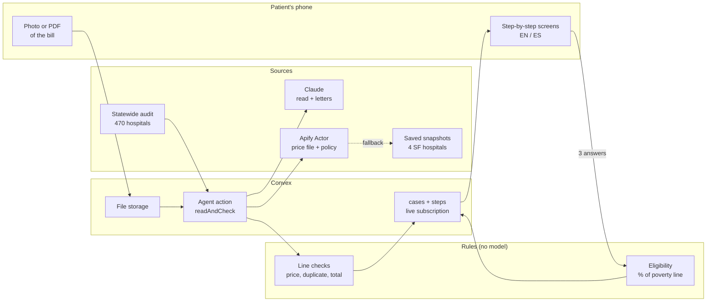
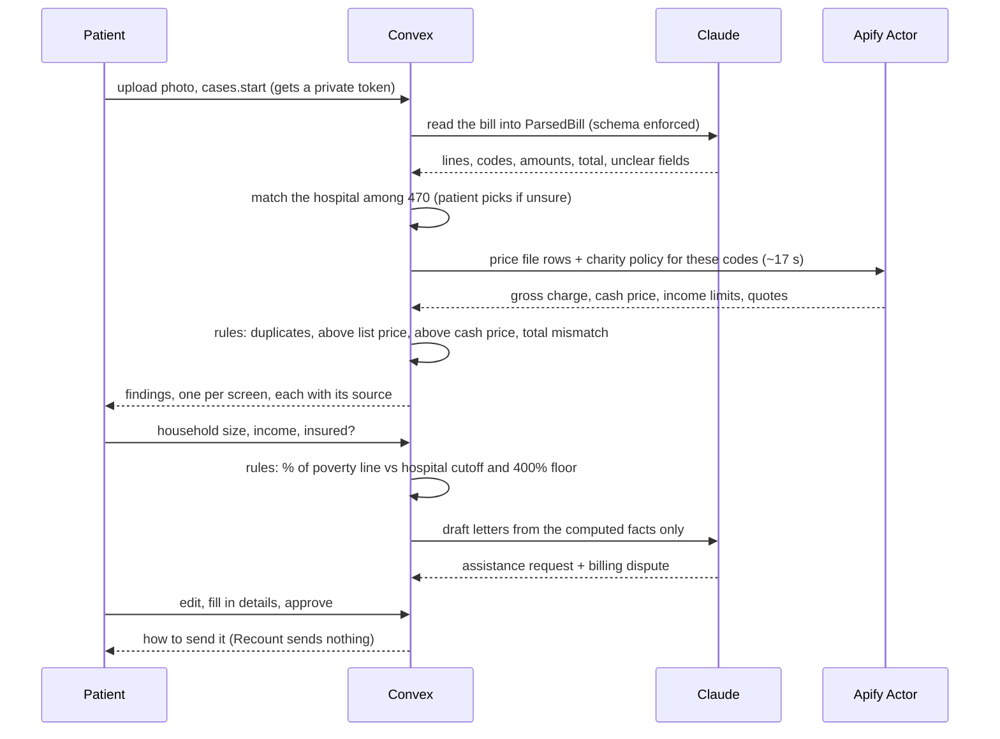
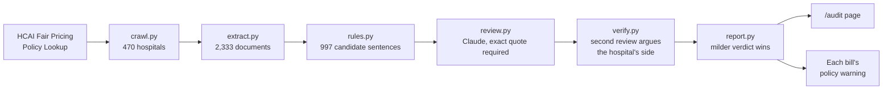
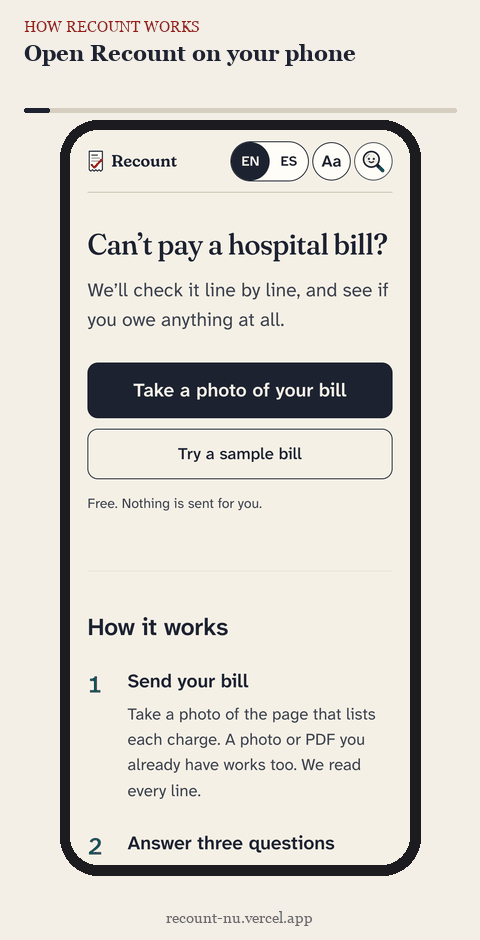

<div align="center">

# Recount

**Got an ER bill you can't pay?** Recount reads a photo of a California hospital bill, checks every line against the
hospital's **own published prices**, applies **California's charity care law** to your household, flags where the
hospital's **own policy breaks state law**, and drafts the letters to ask for a discount. **You approve. Nothing is sent
for you.**

<br/>


<br/>

</div>

---

**Hackathon:** Cal Hacks 13.0 (San Francisco, Oct 23 to 25, 2026)<br/>
**Tracks:** Microsoft Built for the Real World · Anthropic Claude for Public Benefit · Best Use of Apify · Best Actor (Apify) · Best Use of Convex · Best People-First Hack<br/>
**Team:** Volodymyr Borysenko<br/>
**Live demo:** [recount-nu.vercel.app](https://recount-nu.vercel.app) (open it on a phone, tap **Try a sample bill**)

| Page | What you'll find |
|------|------------------|
| [Start](https://recount-nu.vercel.app) | Take a photo of your bill, or try the sample bill. English and Spanish |
| [Your bill](https://recount-nu.vercel.app) | One step per screen: what we found, three questions, your answer, your letters, how to send them |
| [My bills](https://recount-nu.vercel.app/bills) | Every bill you checked, saved on this phone. No account |
| [Hospital policy audit](https://recount-nu.vercel.app/audit) | All 470 California hospitals on a map: whose own policy conflicts with state law, with the quote |
| [Apify Actor](https://apify.com/enterprising_arboretum_iq2/hospital-price-and-charity-finder) | Hospital Price & Charity Care Finder, public on the Apify Store |
| [Android app](https://expo.dev/artifacts/eas/Wcsx-6EwcgMjTyNtfPZ0E4dWNB_XredZx_Wvxz_WQvE.apk) | The same flow as a native app (Expo), on the same backend |

---

## The Problem

An uninsured ER visit in San Francisco can produce a **five figure bill**. California law already says many of these
patients owe much less:

- Hospitals must offer discounted care to uninsured patients up to **400% of the federal poverty line**. For one person
  in 2026 that is **$63,840 a year**.
- Since **January 2025**, hospitals **can't count your assets**, **can't set a deadline** to apply, **can't report the
  debt to credit bureaus**, and **can't put a lien on your home**.
- Many hospitals give **free** care below their own cutoff. Zuckerberg San Francisco General's is **138%** of the poverty
  line, about $22,000 a year for one person.

Most patients never find out. The numbers needed to check a bill are public, but they sit in **hospital price files of
90 MB or more** and in **40-page policy PDFs**. So people pay, or the bill goes to collections.

**Recount does the checking from a phone in a few minutes**, and every number it shows links to the document it came
from.

---

## Built With

| Area | Stack |
|------|-------|
| **Web app** | Next.js 16 (App Router) · React 19 · TypeScript · English and Spanish strings for everything the patient reads |
| **Backend** | Convex: case documents, file storage for the photo, scheduled actions, a live step log the phone subscribes to, upload rate limit |
| **AI** | Claude (Opus 5.5) via the Anthropic API: reads the bill into a typed schema, drafts the letters, reviewed the statewide audit |
| **Rules** | Plain TypeScript: price checks, duplicate and total checks, eligibility under CA Health and Safety Code 127400 and after |
| **Hospital data** | Apify Actor (Python): finds and streams each hospital's CMS price file, extracts charity care limits with quotes |
| **Policy audit** | Python: HCAI crawl, PDF text extraction, regex candidates, two Claude reviews with a quote check |
| **Eval** | Python: synthetic SF ER bills priced from real price files, planted errors, rendered as scans, photos and PDFs |
| **Mobile** | Expo (React Native), Android APK built with EAS |
| **Hosting** | Vercel (web) · Convex Cloud (backend) · Apify (Actor) |

---

## Architecture at a Glance



### One bill, start to finish



### The statewide policy audit



---

## How It Works

<div align="center">



<sub>The real app at phone size, recorded on the live site with the sample bill.</sub>

</div>

**Also in the app:** a one-screen intro on first visit · **Lupa**, a helper chat that answers questions about your bill
· a **Display** mode with larger type for low vision · "Change my answers" · a send checklist after you approve.

**Where Claude is used, and where it is not**

| Step | Who does it | Why |
|------|-------------|-----|
| Read the bill photo | **Claude** | Bills are messy photos. Output is forced into a schema and unclear fields are flagged |
| Find price files and policies | Apify Actor, plain code | No model. It crawls and streams files |
| Flag bad charges | **Rules only** | Every flag points at a bill line and a published number |
| Decide eligibility | **Rules only** | A wrong "you qualify" costs a family real money |
| Draft letters | **Claude**, template fallback | Claude gets only the computed facts as JSON |
| Lupa helper chat | **Claude** | Answers questions about this bill from its facts. It doesn't change answers or send anything |
| Review audit sentences | **Claude**, twice, with a quote check | A verdict is dropped if its quote isn't in the policy text |
| Send anything | Nobody | The patient sends the letters |

---

## Results

### The statewide policy audit

We crawled HCAI's Hospital Fair Pricing Policy Lookup for **all 470** listed California hospitals and extracted text from
**2,333** policy documents (**463** hospitals readable; 7 had only scanned PDFs). We checked six rules from the 2025 law
changes: no application deadlines, no asset tests, limited income proof, no credit reporting, no liens on a home, no
Medi-Cal-first requirement.

| Result | Hospitals |
|--------|-----------|
| **Plain conflict with state law** | **14** |
| Likely conflict | 47 |
| Wording worth asking about | 192 |

Each hospital is counted once, under its strongest result. The three numbers are never added up.

- **Example: PIH Health Whittier Hospital.** Its charity care policy says it will "consider individual or family net
  worth including all liquid and non-liquid assets owned". Its debt collection policy says "Collection agencies may
  notify the credit reporting agencies of the outstanding balance … after 180 days" and "Under certain circumstances when
  income does not exceed 400% FPL, PIH’s collection agency may file a lien on a primary residence". California bans all
  three. Both documents are dated 2026-07-10.
- **The second review clears flags too.** An earlier pass flagged San Francisco General's income proof wording. The
  second review found a fair compliant reading and cleared it. We'd rather miss a problem than accuse a hospital wrongly.

These are our readings of public documents, not legal findings. Every flag on [/audit](https://recount-nu.vercel.app/audit)
shows the policy's own words, the page, and the document's effective date.

### The bill checks

`eval/` generates synthetic San Francisco ER bills priced from each hospital's **real published charges**, plants known
errors in most of them, and renders them as clean scans, phone photos and PDFs.

- **Rules on a correct reading:** **24 of 24** planted errors caught, **0** false alarms on clean bills.
- **Claude on the sample photo:** **8 of 8** lines and the **$12,741** total read correctly.
- **Live QA uploads:** a rotated, blurred photo read all 7 lines and its total; a ZSFG PDF and a CPMC photo flag exactly
  their planted errors (a total mismatch, a $647 duplicate) and nothing else.

**Caveat.** Live reading accuracy hasn't been scored on the full eval set yet.

### The sample bill

Alex Rivera (fictional) owes **$12,741** to Zuckerberg San Francisco General, priced from the hospital's real charges.
Recount finds a **blood count billed twice ($269)** and a **chest X-ray billed at $482 against a published $402**. One
person earning $20,000 is at **125%** of the poverty line, under the hospital's **138%** free care cutoff, so the answer
is **"You likely owe $0"**, with both rules shown.

---

## Path to Production

- **Any California hospital.** Hospital matching, eligibility, letters and the policy warning work for all 470.
  Free-care cutoffs come from each hospital's own policy for **159 of 470**, kept only where the quoted sentence ties the
  number to free care. Every other hospital gets the state's 400% discount rule, never a guessed "free".
  Line-by-line price checks are live for four San Francisco hospitals (ZSFG, UCSF, CPMC Van Ness, Saint Francis), and
  the app says so for every other hospital. The Actor reads any US hospital's price file, so adding a hospital means
  verifying its file, not writing code.
- **Cost.** One bill read is about **$0.04** of Claude (2,449 input and 1,422 output tokens). With letters, a bill costs on
  the order of 10 cents.
- **Privacy without accounts.** Each bill opens only with a random secret kept on the patient's phone, in the link
  fragment, which never reaches a server. Patients can delete a bill and its photo. Uploads are rate-limited.
- **Honest fallbacks.** If the live lookup or the model fails, the app uses saved data or standard letters and labels
  which one you got.

---

## Run It

```bash
npm install
npx convex dev                                   # starts a Convex dev backend, writes .env.local
npx convex env set ANTHROPIC_API_KEY sk-ant-...  # needed to read real photos and write letters
npx convex env set APIFY_TOKEN ...               # optional: live hospital lookups
npx convex env set APIFY_ACTOR_ID NXiKTRZKK6p6qCSXk
npm run dev                                      # http://localhost:3000
npx vitest run                                   # rule tests (tests/)
```

Without an API key, the sample bill still works from its source data and letters come from fixed templates. Both are
labeled in the app.

Data pipelines (Python, run with `-I`):

```bash
python3 -I audit/crawl.py && python3 -I audit/extract.py   # HCAI policies -> audit/corpus/
python3 -I audit/verify.py batches 40                     # second review of flagged sentences
python3 -I audit/report.py                                # -> public/audit/findings.json, convex/lib/auditFindings.json
python3 -I pipeline/build_snapshots.py                    # price files -> convex/lib/snapshots/
cd eval && python -I generate.py && python -I score.py --oracle   # synthetic bills, score the rules
```

Mobile: see [mobile/README.md](mobile/README.md). Actor: see [actor/README.md](actor/README.md).

---

## Code Map

| Path | What |
|------|------|
| `src/app/` | Pages: start (`/`), a bill (`/case/[id]`), My bills (`/bills`), the audit (`/audit`) |
| `src/components/flow/` | The step-by-step bill screens |
| `src/components/audit/` | Audit map, search and the policy-vs-law view |
| `src/components/i18n/` | English and Spanish strings, language toggle |
| `src/components/bills/` | My bills, saved in this phone's storage |
| `convex/schema.ts` | Tables: cases, steps, hospitals, limits, chatMessages |
| `convex/cases.ts` | Upload, start, household answers, line fixes, approve, delete |
| `convex/agent.ts` | The agent action: read with Claude, hospital lookup, checks, letters |
| `convex/lib/checks.ts` | Line checks: duplicates, list price, cash price, totals |
| `convex/lib/eligibility.ts` | Charity care rules: poverty line, hospital cutoff, 400% floor |
| `convex/lib/hospital.ts` | Matching a bill to one of 470 hospitals |
| `convex/lib/letters.ts` | Letter templates and facts handed to Claude |
| `convex/lib/snapshots/` | Saved price data for the four SF hospitals |
| `actor/` | Apify Actor: price file finder and streamer, charity policy limit extractor |
| `audit/` | Statewide HCAI crawl, extraction, rule candidates, two reviews, report |
| `pipeline/` | Hospital index, price snapshots, income cutoffs with quotes |
| `eval/` | Synthetic bill generator, renderer and scorer |
| `mobile/` | Expo app on the same Convex backend |
| `docs/HOW-IT-WORKS.md` | A code tour with line links |

---

## Limits

- **Price checks for four San Francisco hospitals.** Other California hospitals get eligibility, the policy warning and
  letters, but no line-by-line price check.
- **ER codes only.** Saved price data covers 17 to 23 common ER codes per hospital.
- **Hospital bills only.** ER physician bills are separate and follow different rules (HSC 127450 and after).
- **No payment cap amount.** The law caps discounted bills at what Medicare or Medi-Cal would pay. Price files don't
  publish those rates, so Recount explains the cap but doesn't compute it.
- **Audit gaps.** 7 hospitals have only scanned PDFs. "Worth asking" flags got one review, not two. Some policies on file
  are from 2022, and the audit judges the latest one HCAI holds.
- **No accounts.** My bills lives on one phone. Anyone with a bill's private link can open it.
- **Not legal or medical advice.** Recount checks a bill against public rules and prices. The hospital makes the final
  decision.
