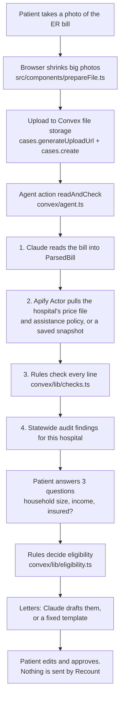

# How Recount works

A five-minute code tour. Links go straight to the lines. Backend line numbers are checked against commit `3588f83`. Frontend files under `src/` are being edited during the hackathon, so for those we name the function instead of the line.

## The flow



The browser subscribes to the case with a Convex query, so every step shows up live in the step log as the action writes it.

## Where Claude is used, and where it is not

| Step | Who does it | Why |
|---|---|---|
| Read the bill photo or PDF into fields | **Claude** ([agent.ts L36-54](../convex/agent.ts#L36-L54)) | Bills are messy photos. Output is forced into a schema ([bill.ts L15-32](../convex/lib/bill.ts#L15-L32)) and unclear fields are listed in `unreadable` |
| Find the price file and policy | Apify Actor, plain code ([actor/src/main.py](../actor/src/main.py)) | No model. It crawls and streams files |
| Flag bad charges | **Rules only** ([checks.ts L34-144](../convex/lib/checks.ts#L34-L144)) | Every flag must point at a bill line and a published number |
| Decide eligibility | **Rules only** ([eligibility.ts L47-150](../convex/lib/eligibility.ts#L47-L150)) | A model must never tell someone they qualify. Each answer lists the rule and source it used |
| Draft letters | **Claude**, with a fixed template as fallback ([agent.ts L167-212](../convex/agent.ts#L167-L212), [letters.ts](../convex/lib/letters.ts)) | Claude gets only the computed facts as JSON and is told not to add law, amounts or names |
| Review audit sentences | **Claude**, twice, with a quote check ([audit/review.py](../audit/review.py), [audit/verify.py](../audit/verify.py)) | Regex finds candidates. A reviewer judges each one in context. A verdict is dropped if its quote isn't in the policy text |
| Send anything | Nobody | The patient sends the letters. There is no send code |

The model id is set once at [agent.ts L19](../convex/agent.ts#L19).

## The pieces

### 1. Upload (frontend)
- `src/components/StartScreen.tsx`: the start page. `StartScreen` gets an upload URL, posts the file, and calls `cases.create`. The sample button fetches `/sample-bill.png` and creates a case with `sample: true`.
- `src/components/prepareFile.ts`: `prepareFile` checks the file type and redraws big or unusual photos (HEIC, huge phone photos) as a JPEG under 3.5 MB.

### 2. Case records (Convex)
- [convex/schema.ts](../convex/schema.ts): three tables. `cases` holds everything about one bill. `steps` is the live log. `hospitals` caches live Actor results.
- [convex/cases.ts](../convex/cases.ts)
  - `generateUploadUrl` [L7-10](../convex/cases.ts#L7-L10) and `create` [L12-25](../convex/cases.ts#L12-L25). `create` schedules the agent action right away.
  - `get` [L27-39](../convex/cases.ts#L27-L39) returns the case, its steps and the photo URL.
  - `submitHousehold` [L41-58](../convex/cases.ts#L41-L58) runs `assess` (rules) inside a mutation, then schedules the letters.
  - `approve` [L60-65](../convex/cases.ts#L60-L65) saves the patient's edited letters and marks the case approved. It sends nothing.

### 3. The agent action
[convex/agent.ts](../convex/agent.ts) `readAndCheck` [L90-154](../convex/agent.ts#L90-L154):
1. **Read** [L96-126](../convex/agent.ts#L96-L126). `readWithClaude` [L36-54](../convex/agent.ts#L36-L54) sends the image or PDF with `READ_PROMPT` [L21-26](../convex/agent.ts#L21-L26) and parses the reply against the Zod schema `ParsedBill`. If the model fails on the sample, it loads the sample's source data and says so in the step log.
2. **Hospital lookup** `lookupHospital` [L56-88](../convex/agent.ts#L56-L88). Matches the name on the bill against `KNOWN_HOSPITALS` ([reference.ts L19-24](../convex/lib/reference.ts#L19-L24)). If `APIFY_TOKEN` and `APIFY_ACTOR_ID` are set it runs the Actor live (up to 180 s) and caches the result. Otherwise it uses the cached result or a saved snapshot ([convex/lib/snapshots/](../convex/lib/snapshots)).
3. **Checks** [L131-142](../convex/agent.ts#L131-L142) call `checkBill`.
4. **Policy findings** [L143-147](../convex/agent.ts#L143-L147) attach what the statewide audit found in this hospital's own policy (`policyFindingsFor`, [reference.ts L48-53](../convex/lib/reference.ts#L48-L53)).

### 4. Bill checks (rules)
[convex/lib/checks.ts](../convex/lib/checks.ts) `checkBill` [L34-144](../convex/lib/checks.ts#L34-L144):
- Summary bill, no lines to check [L37-48](../convex/lib/checks.ts#L37-L48).
- Duplicate line: same code, date and amount [L50-75](../convex/lib/checks.ts#L50-L75). Marked "check", since two doses can be real.
- Above the hospital's own list price, and cash price gap for self-pay patients [L77-121](../convex/lib/checks.ts#L77-L121). Each finding carries the published number and the price file URL.
- Lines don't add up to the printed total [L123-141](../convex/lib/checks.ts#L123-L141).

### 5. Eligibility (rules)
[convex/lib/eligibility.ts](../convex/lib/eligibility.ts) `assess` [L47-150](../convex/lib/eligibility.ts#L47-L150):
- Income as a percent of the 2026 federal poverty line (`povertyLine` [L42-45](../convex/lib/eligibility.ts#L42-L45), table in [reference.ts L11-16](../convex/lib/reference.ts#L11-L16)).
- Insured patients qualify only with high medical costs, over 10% of income [L58-91](../convex/lib/eligibility.ts#L58-L91).
- Free care if under the hospital's own free-care cutoff [L93-114](../convex/lib/eligibility.ts#L93-L114).
- Discount payment up to at least 400% of the poverty line, the state floor [L116-134](../convex/lib/eligibility.ts#L116-L134).
- Otherwise "above the cutoff we found", and still worth asking [L136-149](../convex/lib/eligibility.ts#L136-L149).

Every result carries a `basis` list (rule, plain text, source link). The answer screen prints it under "Why".

### 6. Letters
- Claude path: `draftLetters` [agent.ts L173-212](../convex/agent.ts#L173-L212) with `LETTER_PROMPT` [L167-171](../convex/agent.ts#L167-L171). Input is only the facts JSON (bill, findings, policy findings, eligibility, household).
- Template path: `templateLetters` [letters.ts L25-78](../convex/lib/letters.ts#L25-L78). If the hospital's policy conflicts with state law, `policyNotes` [L89-97](../convex/lib/letters.ts#L89-L97) quotes it next to the law (`LAW_LINE` [L80-87](../convex/lib/letters.ts#L80-L87)).
- `src/components/Letters.tsx`: `Letters` lets the patient edit each letter, then approve. After approval it shows mailto links and the billing phone. Recount never sends.

### 7. The Apify Actor
[actor/](../actor) is a Python Apify Actor, "Hospital Price & Charity Care Finder".
- `run` in [actor/src/main.py L50-196](../actor/src/main.py#L50-L196): reads `cms-hhs-pricetransparency.txt` and crawls the hospital site in parallel, picks the machine-readable price file, then streams it while it researches the assistance policy.
- `scan_url` in [actor/src/mrf.py L337](../actor/src/mrf.py#L337) streams CSV or JSON price files (some are over 90 MB) and keeps only the codes asked for.
- `research_fap` [main.py L199-303](../actor/src/main.py#L199-L303) finds the policy (also through the state HCAI registry, [actor/src/hcai.py](../actor/src/hcai.py)) and pulls free-care and discount cutoffs with `extract_thresholds` ([actor/src/fpl.py L120](../actor/src/fpl.py#L120)).
- It never invents a value. Anything not found is null plus a warning.

### 8. The statewide audit
Goal: check the financial-assistance and debt-collection policies of every California hospital against the 2025 rules.

1. **Crawl** [audit/crawl.py](../audit/crawl.py) walks HCAI's public Hospital Fair Pricing Policy Lookup. 470 hospitals, the latest document of each type, plus geocoding.
2. **Extract** [audit/extract.py](../audit/extract.py) pulls page text from each PDF. Scanned PDFs are marked `needs_ocr`. No OCR yet.
3. **Candidates** [audit/rules.py](../audit/rules.py): six rules (`RULES` [L52-164](../audit/rules.py#L52-L164)): no application deadlines, no asset tests, income proof limited to pay stubs and tax returns, no credit reporting, no liens on homes, no Medi-Cal-first. Each has the statute cite, the law's words, regex patterns, and "complies" patterns that skip plain statements of compliance (`Rule.match` [L39-47](../audit/rules.py#L39-L47)).
4. **Packets** `build_packets` in [audit/review.py L56-98](../audit/review.py#L56-L98): one packet per unique sentence and rule, with three sentences of context on each side. The same wording at many hospitals (system-wide policies) is reviewed once. 980 packets.
5. **First review** (`INSTRUCTIONS` [review.py L38-48](../audit/review.py#L38-L48)): Claude returns conflict, likely, ask or complies, plus the exact words it relied on.
6. **Second review** ([audit/verify.py](../audit/verify.py), `VERIFY` [L21-32](../audit/verify.py#L21-L32)): every conflict or likely flag goes to a second Claude review that argues the hospital's side and clears it if there is a fair compliant reading.
7. **Merge** `load_decisions` in [audit/report.py L28-42](../audit/report.py#L28-L42): a verdict is kept only if its quote is really in the policy text (`valid`, [review.py L112-117](../audit/review.py#L112-L117)). When the two reviews disagree, the milder verdict wins. We'd rather miss than accuse.
8. **Output** [public/audit/findings.json](../public/audit/findings.json) for the `/audit` page, [convex/lib/auditFindings.json](../convex/lib/auditFindings.json) for patient cases, and [audit/results/summary.md](../audit/results/summary.md).

Result: 463 of 470 hospitals had readable text. **15** hospitals have a plain conflict, **135** more are likely, **117** are worth asking about. These are counted separately on purpose.

Frontend: `src/components/audit/AuditApp.tsx` (search and list), `CaMap.tsx` (map), `HospitalView.tsx` ("their policy says" next to "California law says", with page and effective date), data helpers in `src/components/audit/data.ts`.

## Real vs sample vs fallback

| Thing | Real | Sample or fallback | How the UI labels it (English strings; Spanish ones live in `src/components/i18n/strings.ts`) |
|---|---|---|---|
| Bill reading | Claude reads the uploaded file | Sample bill loads `convex/lib/sample.ts` when there's no key or the model fails | Bill card: "read by Claude from your photo" or "sample bill source data". Sources: "Read by Claude ... Check names and amounts" or "Sample bill, loaded from its source data" |
| The sample patient | Fictional (Alex Rivera) | Charges are ZSFG's real published gross charges, with two planted problems (CBC twice, X-ray $482 vs $402) | "The sample bill" on the photo toggle |
| Hospital prices | Live Apify Actor run | Saved snapshot in `convex/lib/snapshots/`, built from the hospitals' real price files by `pipeline/` | Step log and Sources: "Fetched live (date)" or "Saved lookup from (date), not fetched just now" |
| Letters | Claude draft | Fixed template | Letters header: "written by Claude" or "standard template" |
| Audit | `public/audit/findings.json`: real HCAI documents, real quotes with page numbers | `public/audit/findings.sample.json` (71 hospitals, made up for layout work) loads only if the real file is missing | A sample banner shows when the sample file is used (`AuditApp.tsx`). The headline scope follows the data, and confirmed and likely are counted apart |
| `/preview` | Not real | Hard-coded case for design work (`src/components/Preview.tsx`) | Preview page only |

## Data sources
- Prices: each hospital's CMS machine-readable standard-charges file. Six San Francisco hospitals in `pipeline/out/`, four wired into the app.
- Policies: HCAI Hospital Fair Pricing Policy Lookup (public, no login).
- Poverty line: 2026 HHS guidelines, Federal Register 2026-01-15.
- Law: Health and Safety Code 127400 to 127446 as amended by AB 1020, AB 2297 and SB 1061. Hand-curated in `pipeline/scripts/curated/ca_law.json`, see the caveats in [pipeline/DATA.md](../pipeline/DATA.md).

## Limits we know about
Tracked as issues on GitHub (see [LOGBOOK.md](LOGBOOK.md#open-issues)). The main ones:
- Only four San Francisco hospitals are wired up for the bill check. Other hospitals get eligibility, letters and the audit, but no price check.
- Saved snapshots are missing each hospital's free-care cutoff and policy link (#11), so eligibility falls back to the 400% state floor.
- The discount answer gives no dollar estimate. The legal cap is tied to Medicare or Medi-Cal rates, and price files don't publish Medicare fee-for-service rates.
- Name matching is loose (#14). The Actor is called with its default ER code list, so codes outside that list aren't priced.
- Cases have no sign-in. Anyone with the link can open one (#6). "My bills" lives on the phone only (#9).
- Audit: 7 hospitals couldn't be read (#10). "Ask" verdicts were reviewed once. Only conflict and likely flags got the second review. Policies on file can be old (some from 2022), and the audit judges the latest one HCAI has.
- ER doctor bills are separate from the hospital bill and follow different rules (HSC 127450 and up). Recount only handles the hospital bill.
- Not legal advice. Statute quotes come from FindLaw and HCAI because leginfo blocks automated fetches.

## Run it
```sh
npm install
npx convex dev          # needs ANTHROPIC_API_KEY set with `npx convex env set` for real photos
npm run dev             # http://localhost:3000
npx vitest run          # rule tests in tests/rules.test.ts
```
Optional: `APIFY_TOKEN` and `APIFY_ACTOR_ID` in Convex env for live lookups.
