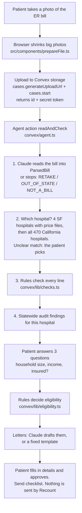

# How Recount works

A five-minute code tour. Links go straight to the lines.
- Backend line numbers (`convex/`, `pipeline/`, `mobile/`) were checked against `origin/main` at `494f50e`.
- Frontend files (`src/`) were checked against branch `ui` at `74cd5f0`. The frontend changes fast, so for `src/` we name the function instead of the line.

## The flow



The phone subscribes to the case with a Convex query, so each step shows up live as the action writes it. The web app and the Expo app in `mobile/` use the same backend.

**Live today:** Claude reads real photos (the sample photo reads 8 of 8 lines, $12,741). Claude writes the letters. The published Apify Actor (ID `NXiKTRZKK6p6qCSXk`) fetches prices and policy live. For the four San Francisco hospitals, the app answers right away from checked saved data and refreshes the live data in the background.

## Where Claude is used, and where it is not

| Step | Who does it | Why |
|---|---|---|
| Read the bill photo or PDF into fields | **Claude** ([agent.ts L38-56](../convex/agent.ts#L38-L56)) | Bills are messy photos. Output is forced into a schema ([bill.ts](../convex/lib/bill.ts)), and unclear parts are listed in `unreadable` in plain words |
| Find the price file and policy | Apify Actor, plain code ([actor/src/main.py](../actor/src/main.py)) | No model. It crawls and streams files |
| Match the hospital | **Rules** ([statewide.ts L63-81](../convex/lib/statewide.ts#L63-L81)) | Word overlap with city and address. If it isn't clear, the patient picks |
| Flag bad charges | **Rules only** ([checks.ts L34-188](../convex/lib/checks.ts#L34-L188)) | Every flag must point at a bill line and a published number |
| Decide eligibility | **Rules only** ([eligibility.ts L50-153](../convex/lib/eligibility.ts#L50-L153)) | A model must never tell someone they qualify. Each answer lists the rule and source it used |
| Hospital income cutoffs (input to the rules) | Rule extractor first. **Claude** filled in 70 of the 441 cutoffs the extractor missed ([pipeline/extract_cutoffs_claude.py](../pipeline/extract_cutoffs_claude.py)) | A Claude value is kept only if its quote is word for word in the policy and contains the number. These values are offline data, not decisions |
| Draft letters | **Claude**, with a fixed template as fallback ([agent.ts L337-426](../convex/agent.ts#L337-L426), [letters.ts](../convex/lib/letters.ts)) | Claude gets only the computed facts as JSON. It is told not to add law, amounts or names, and never to say the patient qualifies |
| Answer questions in the helper chat (Lupa) | **Claude** ([chatAgent.ts](../convex/chatAgent.ts)) | Explains the case in plain words. The safety prompt forbids claiming eligibility beyond the computed result, or saying anything was sent |
| Review audit sentences | **Claude**, with a quote check ([audit/review.py](../audit/review.py), [audit/verify.py](../audit/verify.py)) | Regex finds candidates. Every conflict and likely flag was reviewed twice; "worth asking" flags were reviewed once. A verdict is dropped if its quote isn't in the policy text |
| Send anything | Nobody | The patient sends the letters. There is no send code |

The model id is set at [agent.ts L20](../convex/agent.ts#L20) and [chatAgent.ts L8](../convex/chatAgent.ts#L8).

## The pieces

### 1. Start and upload (frontend)
- `src/components/StartScreen.tsx`: `StartScreen` is the start page. First-time visitors see the before-you-start screens (`src/components/onboarding/Onboarding.tsx`, remembered in `seen.ts`). Then it gets an upload URL, posts the file, and calls `cases.start` with the patient's language.
- `src/components/prepareFile.ts`: `prepareFile` checks the file type and redraws big or unusual photos (HEIC, huge phone photos) as a JPEG under 3.5 MB, below the model's 5 MB image limit.

### 2. Case records and access (Convex)
- [convex/schema.ts](../convex/schema.ts): `cases`, `steps` (the live log), `chatMessages`, `limits` (upload rate limits) and `hospitals` (cached live lookups).
- [convex/cases.ts](../convex/cases.ts)
  - Access [L12-28](../convex/cases.ts#L12-L28): each case has a random secret token. `owned` and `mustOwn` check it on every call. The phone keeps the token, and the case link carries it in the hash (`#t=`), which never reaches a server. There is no login on purpose (see Decisions in the logbook).
  - `limit` [L30-41](../convex/cases.ts#L30-L41) caps uploads and new cases per minute. `generateUploadUrl` [L43-49](../convex/cases.ts#L43-L49).
  - `start` [L58-76](../convex/cases.ts#L58-L76) creates the case and its token and schedules the agent action.
  - `get` [L96-110](../convex/cases.ts#L96-L110) returns the case without its token.
  - `submitHousehold` [L112-130](../convex/cases.ts#L112-L130) runs `assess` (rules) inside a mutation, then schedules the letters.
  - `approve` [L141-157](../convex/cases.ts#L141-L157) checks the letters' shape and size and only works on a ready or approved case. With `requireFilled` it refuses letters that still have a `[blank]` (signature lines excepted) with a `FILL_IN:` message. It sends nothing.
  - `correctLine` [L159-182](../convex/cases.ts#L159-L182): the patient fixes a misread amount and the rule checks run again.
  - `unapprove` [L184-192](../convex/cases.ts#L184-L192), `confirmHospital` [L194-204](../convex/cases.ts#L194-L204), `remove` [L206-216](../convex/cases.ts#L206-L216) (deletes the case, its log and the photo), `searchHospitals` [L218-235](../convex/cases.ts#L218-L235).
  - Errors the patient should read are thrown as `ConvexError`, so production shows the real message.

### 3. The agent action
[convex/agent.ts](../convex/agent.ts) `readAndCheck` [L243-319](../convex/agent.ts#L243-L319):
1. **Read** [L251-294](../convex/agent.ts#L251-L294). `readWithClaude` [L38-56](../convex/agent.ts#L38-L56) sends the image or PDF with `READ_PROMPT` [L22-28](../convex/agent.ts#L22-L28) and parses the reply against the Zod schema `ParsedBill`. Three plain stops [L272-282](../convex/agent.ts#L272-L282):
   - `RETAKE` when no charges could be read,
   - `OUT_OF_STATE` when the hospital address is outside California,
   - `NOT_A_BILL` when it isn't a medical bill.

   The UI turns each code into its own screen (`ReadingStep` in `src/components/flow/MainScreens.tsx`).
2. **Which hospital** [L296-313](../convex/agent.ts#L296-L313). First the four San Francisco hospitals with price files (`KNOWN_HOSPITALS`, [reference.ts L19-24](../convex/lib/reference.ts#L19-L24)). Then `matchHospital` ([statewide.ts L63-81](../convex/lib/statewide.ts#L63-L81)) over all 470 California hospitals in `convex/lib/hospitalIndex.json`. It needs a clear winner. Otherwise the case waits in `confirm_hospital`, and the patient picks one (`HospitalStep`) or searches.
3. **Prices and policy** `finishCheck` [L190-241](../convex/agent.ts#L190-L241) calls `resolveRef` [L173-188](../convex/agent.ts#L173-L188).
   - For an SF hospital, `lookupHospital` [L111-146](../convex/agent.ts#L111-L146) uses saved data at once and schedules `refreshHospital` [L148-161](../convex/agent.ts#L148-L161) in the background. It only waits on the Actor when nothing is saved.
   - `liveLookup` [L87-109](../convex/agent.ts#L87-L109) calls the Actor over the Apify REST API with the bill's codes. `fromActor` [L58-83](../convex/agent.ts#L58-L83) normalizes the result. For any code in both, the hand-checked snapshot row wins, so a different variant of a code can't create a false flag.
   - For any other California hospital, `refFromIndex` ([statewide.ts L83-101](../convex/lib/statewide.ts#L83-L101)) gives the hospital's own policy and cutoffs but no prices, and the step log says so.
   - `warningsForBill` [L163-171](../convex/agent.ts#L163-L171) only warns about codes on this bill.
4. **Checks and policy findings** inside `finishCheck`: `checkBill`, `potentialSavings` for the "Up to $X" line, and `policyFindingsFor` ([reference.ts L48-53](../convex/lib/reference.ts#L48-L53)). The step log counts conflicts, likely conflicts and "worth asking" separately.

### 4. Bill checks (rules)
[convex/lib/checks.ts](../convex/lib/checks.ts) `checkBill` [L34-188](../convex/lib/checks.ts#L34-L188):
- Summary bill, no lines to check [L38-52](../convex/lib/checks.ts#L38-L52).
- Duplicate line: same code, date and amount [L54-83](../convex/lib/checks.ts#L54-L83). Marked "check", since two doses can be real.
- Above the hospital's own list price, and the cash price gap for self-pay patients [L84-140](../convex/lib/checks.ts#L84-L140). A line above both is one finding, not two [L142-153](../convex/lib/checks.ts#L142-L153).
- Lines don't add up to the printed total [L155-185](../convex/lib/checks.ts#L155-L185). If part of the photo was unclear, the gap counts as $0, since a misreading is more likely than bad math.
- `potentialSavings` [L190-207](../convex/lib/checks.ts#L190-L207): the most a patient could save, one amount per line.

### 5. Eligibility (rules)
[convex/lib/eligibility.ts](../convex/lib/eligibility.ts) `assess` [L50-153](../convex/lib/eligibility.ts#L50-L153):
- Income as a percent of the 2026 federal poverty line (`povertyLine` [L43-46](../convex/lib/eligibility.ts#L43-L46), table in [reference.ts L11-16](../convex/lib/reference.ts#L11-L16)).
- Insured patients qualify only with high medical costs, over 10% of income [L75-98](../convex/lib/eligibility.ts#L75-L98).
- Free care at or under the hospital's own free-care cutoff [L100-116](../convex/lib/eligibility.ts#L100-L116). The cutoff comes from the hospital's policy: ZSFG 138% of the poverty line, the other SF snapshots 400%, and 441 of the 470 statewide hospitals have one in the index.
- Discount payment up to at least 400% of the poverty line, the state floor [L118-142](../convex/lib/eligibility.ts#L118-L142).
- Otherwise "above the cutoff we found", and still worth asking [L144-152](../convex/lib/eligibility.ts#L144-L152).

Every result carries a `basis` list (rule, plain text, source link). The answer screen shows it under "Why".

### 6. Letters and sending
- Claude path: `draftLetters` [agent.ts L358-426](../convex/agent.ts#L358-L426) with `LETTER_PROMPT` [L350-356](../convex/agent.ts#L350-L356). One call per letter, run in parallel.
- Template path: `templateLetters` [letters.ts L172-179](../convex/lib/letters.ts#L172-L179). If the hospital's policy conflicts with state law, the assistance letter quotes it next to the law ([L91-93](../convex/lib/letters.ts#L91-L93), `LAW_LINE` [L31-56](../convex/lib/letters.ts#L31-L56)). The credit reporting line cites SB 1061 (2024).
- Letters to the hospital are always in English. A Spanish case also gets a read-only Spanish copy under "Lo que dice su carta".
- Frontend, all in `src/components/`:
  - `flow/LetterScreens.tsx`: `DetailsStep` asks for the required details (name, address and so on). They are saved in a local profile, `profile.ts`, and offered again on the next bill. `LetterStep` shows one letter per screen and approves with `requireFilled: true`. `SendStep` shows the check mark screen.
  - `SendGuide.tsx`: a 4-step send checklist (call, send, pause collections, apply), with progress saved on the phone.
  - `PrintLetters.tsx`: print-ready letters.

### 7. One step per screen (frontend)
- `src/components/flow/steps.ts`: `stepsFor` lists the screens a case has right now, in order. `homeStep` picks where to land, and `phaseOf` gives "Step x of 4".
- `src/components/flow/useStep.ts`: `useStep` keeps the current screen in the link (`#t=<token>&s=<step>`). The phone's Back button works, and screens slide with View Transitions where the browser supports them.
- `src/components/flow/StepFrame.tsx`: `StepFrame` is the shared frame with Back and the primary button side by side in a pinned bar.
- `src/components/flow/FoundScreens.tsx`: `FoundStep` and `FindingStep` show one clean card per problem. `MainScreens.tsx` has the reading, hospital, question, answer and "More" screens. `CaseFlow.tsx` picks the screen.

### 8. Access for older and Spanish-speaking patients (frontend)
- Display mode for low vision: `src/components/a11y/vision.ts` and `VisionToggle.tsx`. Text size and contrast are saved per device and applied before the first paint. A system "more contrast" setting turns it on by default.
- Spanish and English: `src/components/i18n/` with the dictionaries in `en.json` and `es.json` (template syntax in `format.ts`, key types and lookup in `strings.ts`). The backend writes step labels, findings and reasons in the case's language.
- Lupa, the helper: `src/components/helper/` (`HelperButton`, `HelperChat`, `Mascot`, `chatApi.ts`). Backend `chat.send` and `chat.list` in [convex/chat.ts](../convex/chat.ts). It is limited to 20 questions per 10 minutes and one reply at a time. The reply streams from `reply` in [convex/chatAgent.ts](../convex/chatAgent.ts), with the case passed as marked data, never as instructions (`SYSTEM` [L10-26](../convex/chatAgent.ts#L10-L26)).
- "My bills": `src/components/bills/`, case ids and tokens kept on this phone.
- The research behind these choices is in [DESIGN-RESEARCH.md](DESIGN-RESEARCH.md).

### 9. The Apify Actor
[actor/](../actor) is a Python Apify Actor, "Hospital Price & Charity Care Finder", published on the Apify Store (ID `NXiKTRZKK6p6qCSXk`), with an output schema in `actor/.actor/`.
- `run` in [actor/src/main.py L50-196](../actor/src/main.py#L50-L196): reads `cms-hpt.txt` (then the legacy `cms-hhs-pricetransparency.txt`) and crawls the hospital site in parallel, picks the machine-readable price file, then streams it while it researches the assistance policy.
- `scan_url` in [actor/src/mrf.py L337](../actor/src/mrf.py#L337) streams CSV or JSON price files (some are over 90 MB) and keeps only the codes asked for.
- `research_fap` [main.py L199-303](../actor/src/main.py#L199-L303) finds the policy (also through the state HCAI registry, [actor/src/hcai.py](../actor/src/hcai.py)) and pulls free-care and discount cutoffs with `extract_thresholds` ([actor/src/fpl.py L120](../actor/src/fpl.py#L120)). The same extractor builds the statewide hospital index ([pipeline/build_hospital_index.py](../pipeline/build_hospital_index.py)).
- It never invents a value. Anything not found is null plus a warning.

### 10. The statewide audit
Goal: check the financial-assistance and debt-collection policies of every California hospital against the 2025 rules.

1. **Crawl** [audit/crawl.py](../audit/crawl.py) walks HCAI's public Hospital Fair Pricing Policy Lookup. 470 hospitals, the latest document of each type, plus geocoding.
2. **Extract** [audit/extract.py](../audit/extract.py) pulls page text from each PDF. Scanned PDFs are marked `needs_ocr`. No OCR yet.
3. **Candidates** [audit/rules.py](../audit/rules.py): six rules (`RULES` [L52-164](../audit/rules.py#L52-L164)): no application deadlines, no asset tests, income proof limited to pay stubs and tax returns, no credit reporting, no liens on homes, no Medi-Cal-first. Each has the legal cite, the law's words, regex patterns, and "complies" patterns that skip plain statements of compliance (`Rule.match` [L39-47](../audit/rules.py#L39-L47)).
4. **Packets** `build_packets` in [audit/review.py L56-98](../audit/review.py#L56-L98): one packet per unique sentence and rule, with three sentences of context on each side. The same wording at many hospitals (system-wide policies) becomes one packet. 980 packets.
5. **First review** (`INSTRUCTIONS` [review.py L38-48](../audit/review.py#L38-L48)): Claude returns conflict, likely, ask or complies, plus the exact words it relied on. Every packet got this review.
6. **Second review** ([audit/verify.py](../audit/verify.py), `VERIFY` [L21-32](../audit/verify.py#L21-L32)): every conflict or likely flag goes to a second Claude review that argues the hospital's side and clears it if there is a fair compliant reading. "Worth asking" flags from the first review do not get a second review.
7. **Merge** `load_decisions` in [audit/report.py L28-42](../audit/report.py#L28-L42): a verdict is kept only if its quote is really in the policy text (`valid`, [review.py L112-117](../audit/review.py#L112-L117)). When the two reviews disagree, the milder verdict wins. We'd rather miss than accuse.
8. **Output** [public/audit/findings.json](../public/audit/findings.json) for the `/audit` page, [convex/lib/auditFindings.json](../convex/lib/auditFindings.json) for patient cases, and [audit/results/summary.md](../audit/results/summary.md).

Result: 463 of 470 hospitals had readable text. **15** hospitals have a plain conflict, **135** more are likely, **117** are worth asking about. These are counted separately on purpose. The 117 can include flags the second review softened, and flags that had only the first review.

Frontend: `src/components/audit/AuditApp.tsx` (search, sorting and list), `CaMap.tsx` (map; a tap on a crowded spot lists the hospitals there), `HospitalView.tsx` ("their policy says" next to "California law says", with page and effective date).

### 11. The mobile app
[mobile/](../mobile) is an Expo (React Native) app for iPhone and Android: camera upload, the same step-by-step case flow, letters with share and copy, "My bills" on the phone, English and Spanish. It calls the same Convex functions, with tokens (`cases.start`). See [mobile/README.md](../mobile/README.md) to try it in Expo Go.

## Real vs sample vs fallback

| Thing | Real | Sample or fallback | How the UI labels it (English; Spanish in `src/components/i18n/es.json`) |
|---|---|---|---|
| Bill reading | Claude reads the uploaded file | The sample bill loads `convex/lib/sampleBill.json` when there's no key or the model fails. The sample PNG is rendered from the same file | "read by Claude from your photo" or "sample bill source data". Sources: "Read by Claude ... Check names and amounts" or "Sample bill, loaded from its source data" |
| The sample patient | Fictional (Alex Rivera) | Charges are ZSFG's real published gross charges, with two planted problems (CBC twice, X-ray $482 vs $402) | "The sample bill" on the photo toggle |
| Hospital prices, 4 SF hospitals | Live Apify Actor run, refreshed in the background | A snapshot built from the hospitals' real price files by `pipeline/` | Step log: "Read X's price file and policy live", or "Using X's price file and policy (live lookup, date)", or "Using X's published prices and assistance policy" with "Extracted from the hospital's published price file and assistance policy by our data pipeline" |
| Other California hospitals | The hospital's own policy filed with HCAI | No price file | Step log: "Found X's financial assistance policy" and "We don't have this hospital's price file, so charges are not compared to its prices" |
| Letters | Claude draft | Fixed template | "written by Claude" or "standard template" |
| Audit | `public/audit/findings.json`: real HCAI documents, real quotes with page numbers | `public/audit/findings.sample.json` (71 made-up hospitals) loads only if the real file is missing | A sample banner shows when the sample file is used |

## Data sources
- Prices: each hospital's CMS machine-readable standard-charges file. Six San Francisco hospitals in `pipeline/out/`, four wired into the app.
- Policies and hospital list: HCAI Hospital Fair Pricing Policy Lookup (public, no login).
- Poverty line: 2026 HHS guidelines, Federal Register 2026-01-15.
- Law: Health and Safety Code 127400 to 127446 as amended by AB 1020 and AB 2297, plus SB 1061 (2024) on credit reporting. Hand-curated in `pipeline/scripts/curated/ca_law.json`, see the caveats in [pipeline/DATA.md](../pipeline/DATA.md).

## Limits we know about
Open issues are on GitHub (see [LOGBOOK.md](LOGBOOK.md#open-issues)).
- Price checks cover 340 of 470 California hospitals: 4 SF hospitals from hand-checked snapshots, and 336 from statewide runs of our Apify Actor (`convex/lib/statewidePrices.json`, built by `pipeline/build_statewide_prices.py` from the files `pipeline/find_price_files.py` verified). A file counts only when it states the hospital's California license number, or names the hospital and no other California hospital's license, and each code uses the highest outpatient list price in the file, so a charge is flagged only when it is above every matching row. On the four hand-checked files, 80 of 81 prices matched exactly and the other 1 were higher (never lower). The rest get eligibility, letters and the audit, but no price check, and the app says why (`priceGap`: notFound, unreadable, notNamed, noCodes).
- The discount answer gives no dollar estimate. The legal cap is tied to Medicare or Medi-Cal rates, and price files don't publish Medicare fee-for-service rates.
- No accounts. "My bills" and the saved profile live on one phone (#9). Anyone holding a case link with its token can open that case. That is how a patient shares a bill on purpose.
- The language is fixed when the case is created. Switching later changes the screens but not text the backend already wrote.
- Audit: 7 hospitals couldn't be read (#10). "Worth asking" flags were reviewed once. Policies on file can be old (some from 2022), and the audit judges the latest one HCAI has.
- ER doctor bills are separate from the hospital bill and follow different rules (HSC 127450 and up). Recount only handles the hospital bill.
- Not legal advice. Statute quotes come from FindLaw and HCAI because leginfo blocks automated fetches.

## Run it
```sh
npm install
npx convex dev          # needs ANTHROPIC_API_KEY set with `npx convex env set` for real photos
npm run dev             # http://localhost:3000
npx vitest run          # rule tests in tests/rules.test.ts
```
Optional: `APIFY_TOKEN` and `APIFY_ACTOR_ID` in Convex env for live lookups. Mobile: see `mobile/README.md`.
